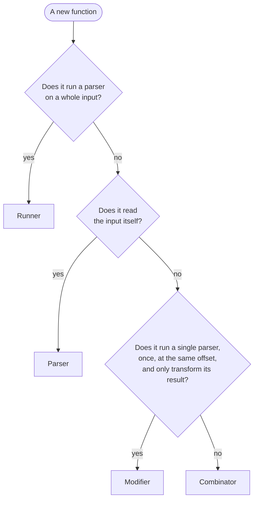

# Contributing to PPC

This guide describes how PPC is organized and the rules every function follows. Read it before adding or changing a
function: most design discussions end up being about which kind a function belongs to.

## Structure

| Path | Content |
|---|---|
| `src/lib/` | the result types (`Result`, `Success`, `Failure`, `Incomplete`) and `SyntaxError` |
| `src/functions/primitives.php` | the parsers |
| `src/functions/combinators.php` | the combinators |
| `src/functions/modifiers.php` | the modifiers |
| `src/functions/parse.php`, `src/functions/stream.php` | the runners |
| `parsers/` | complete parsers built with PPC, e.g. JSON |
| `tests/unit/` | one test class per function, grouped by kind (the `Unit` suite) |
| `tests/examples/` | the tests of the parsers of `parsers/` (the `Examples` suite) |
| `tests/docs/` | runs every `php` code block of the README and the documentation (the `Documentation` suite) |
| `benchmarks/` | PHPBench scenarios (JSON, backtracking…), comparing PPC with other libraries and native functions |
| `benchmarks/Functions/` | one PHPBench benchmark per function, comparing PPC with Parsica |
| `benchmarks/nom/` | the same benchmarks with [nom](https://github.com/rust-bakery/nom), a Rust crate run by criterion |
| `benchmarks/fixtures/` | the inputs of the per-function benchmarks, shared by PHP and Rust |
| `tools/` | development scripts: the coverage check, the combined benchmark report |
| `docs/` | the documentation website (docsify) |

## The parser contract

A parser is a closure:

```phps
\Closure(string $input, int $offset, bool $partial = false): Result
```

It tries to match the input at the offset and returns:

- `Success($value, $offset, $hint)`: the value, the offset after the matched input, and the furthest failure met on
  the way, if any. The hint lets errors point at the furthest position reached, e.g. `Expected "a" or "b"` after
  `many(char('a'))`;
- `Failure($expected, $offset)`: what was expected, and where;
- `Incomplete($needed)`: the input ended before the parser could decide. Only returned when `$partial` is `true`, when
  more input may follow (see `stream()`).

A parser never copies the input: it moves an offset along it. Backtracking is returning to a previous offset, and costs
nothing.

## The four kinds

Every public function belongs to exactly one kind:

| Kind | What it does | Syntax | Naming |
|---|---|---|---|
| **Parser** | reads the input | `char('a')` | what it matches: `char`, `word`, `regex`, `any`, `eos` |
| **Combinator** | assembles parsers, never reads the input itself | `many($p)`, `separated($sep, $p)` | the structure it builds: `seq`, `alt`, `many`, `separated`, `enclosed` |
| **Modifier** | runs the parser once, at the same offset, and only transforms its result | always `$p \|> modifier()` | a verb applied to the parser: `map`, `label`, `debug` |
| **Runner** | runs a parser on an input, in two variants: one throwing the `SyntaxError`, one returning it | `parse($p, $input)` | the action, prefixed with `try` for the returning variant |

Any combination of parsers, combinators and modifiers is a parser.



### Parsers

Parsers are the only functions reading the input. When the input ends before they can decide, they return `Incomplete`
on a partial input, and `Failure` on a complete one.

### Combinators

Combinators take parsers and return a parser. They never read the input themselves: they only call their parsers,
possibly several times, at various offsets. When a combinator needs to match something, it uses a parser, e.g. `anyBut()`
calls `any()`.

Combinators:

- propagate `Incomplete` as is, without interpreting it;
- keep the furthest failure as hint, with `furthest()`, so that errors point at the furthest position reached;
- throw a `LogicException` instead of looping forever, e.g. when the parser repeated by `many()` succeeds without
  consuming input.

### Modifiers

A modifier runs its parser **once, at the offset it is given**, and only transforms the result: the value (`map()`),
the error (`label()`), or the value replaced by the matched text. It may give back the input the parser consumed, but
**never consumes more**.

Modifiers are always applied with the pipe operator, so that `|>` tells at a glance that no more input is read:

```phps
$number = regex('/[0-9]+/') |> label('number') |> map(intval(...));
```

A modifier is a function returning the transformation, which delegates to an `@internal` function taking the parser,
e.g. `map()` returns `static fn (\Closure $parser): \Closure => mapped($parser, $mapper)`.

A function running its parser several times is a combinator, even with a single parser: `many($p)`, not
`$p |> many()`.

### Runners

Runners turn a parser into values. They come in two variants:

- `parse()` and `stream()` throw a `SyntaxError`;
- `tryParse()` and `tryStream()` return it (to come, see [#118](https://github.com/jubianchi/ppc/issues/118)).

Only syntax errors are returned: programming and environment errors, like a parser returning `Incomplete` on a
complete input or an unreadable source, are thrown by both variants.

## Types

PPC is checked by PHPStan at its highest level, and every function carries generic types: a parser returning an `int`
is a `\Closure(string, int, bool=): (Success<int>|Failure|Incomplete)`, and combinators and modifiers keep the types
through `@template`.

Two limitations of PHPStan show up regularly:

- a template is not resolved from the parameter of a closure, typed as a plain `\Closure`: write a generic function
  instead, e.g. `token()` in `parsers/json.php`;
- two functions of the same file declaring `\Closure(T, T): T` get their `T` mixed up: name the template of one of them
  differently, e.g. `U` in `chainRight()`.

## Workflow

Changes are test-driven: write the failing test first, then the code. Each function has its test class in
`tests/unit/`, grouped by kind (`Primitives/`, `Combinator/`, `Modifiers/`), and `tests/unit/IncompleteTest.php` checks that every combinator and modifier propagates
`Incomplete`: add your function there too.

Each function is documented in `docs/reference.md`, with examples run by the docs test: they use `assert()`, so a wrong
example fails the build.

Before submitting:

```bash
composer test              # all the tests, or a single suite:
                           # test:unit, test:examples, test:docs
composer test:coverage     # code coverage, failing under 100% (requires pcov)
composer lint:types        # static analysis
composer lint:style        # code style, fixed by composer fix:style
composer bench:ref         # benchmarks on master, then on your branch:
composer bench:compare     # compared with the reference
composer bench:functions   # the per-function benchmarks, with nom (requires cargo)
```

## Benchmarks

Each parser, combinator and modifier is benchmarked against [Parsica](https://github.com/parsica-php/parsica) and
[nom](https://github.com/rust-bakery/nom), on the same inputs, and `composer bench:functions` prints one table comparing
them:

```
| function | input  | ppc      | parsica | nom       | ppc / nom |
|----------|--------|----------|---------|-----------|-----------|
| many     | 1 kB   | 206.4 µs | 1.72 ms | 2.21 µs   | ×93.6     |
| many     | 100 kB | 20.7 ms  | —       | 185.29 µs | ×111.7    |
```

`many()` is the model to follow:

- **the inputs** are files in `benchmarks/fixtures/<function>/`, read by both languages, so that they parse the same
  bytes;
- **the PHP side** is a class named after the function in `benchmarks/Functions/<Kind>/`, e.g. `Combinators/Many.php`,
  with a `bench_ppc` and a `bench_parsica` subject, and one parameter set per input, e.g. `1 kB`;
- **the Rust side** is a criterion group named after the function in `benchmarks/nom/benches/<kind>.rs`, with one
  `BenchmarkId::new("nom", <input>)` per input, using the same input names;
- **each library checks**, out of the measure, that it consumes the whole input, so that they do the same work;
- **a library without an equivalent**, or too slow on an input, is left out, with a comment saying why: the table then
  shows `—`.

Commits are atomic and follow [Conventional Commits](https://www.conventionalcommits.org/), e.g.
`feat: add preceded() to keep the value after a prefix`. A pull request addresses a single topic.
