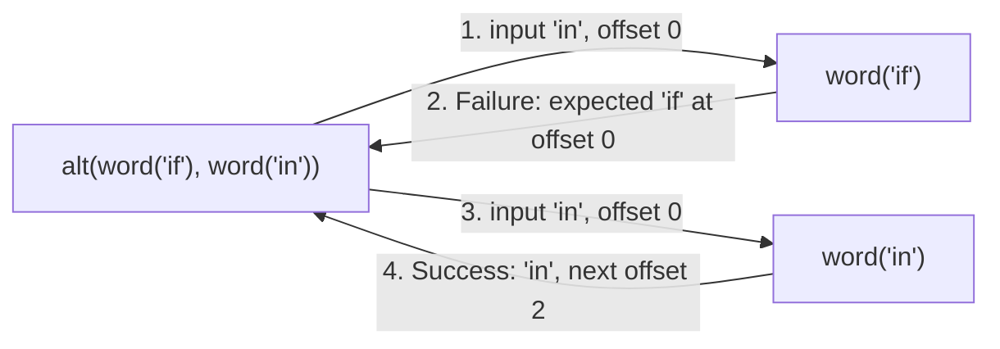

# Reference

> [!WARNING]
> This is the documentation for the `master` branch.
> Things may change or not be complete.
>
> Head over to the [latest stable version](/1.0.0/reference.md) for an up-to-date documentation.

Every function lives in the `jubianchi\PPC` namespace.

## Concepts

### Parsers

A parser is a plain closure taking the whole input and the byte offset to start at:

```phps
\Closure(string $input, int $offset, bool $partial = false): Result
```

`Result` is an interface implemented by three final classes:

* On success, it returns a `Success` holding the parsed `value` and the `offset` right after what it consumed.
* On failure, it returns a `Failure` holding the list of what was `expected` and the `offset` where it was expected.
* On a partial input, when [streaming](#streaming), it returns an `Incomplete` result when the input ends before it can
  decide. Parsers ignoring the `$partial` argument work too, they just cannot be streamed reliably.

The input is never copied nor sliced: parsers only move an offset forward. Backtracking is free, trying an alternative
only means calling another parser with the same offset.



Since parsers are closures, you can write your own:

```php
<?php

use jubianchi\PPC\Failure;
use jubianchi\PPC\Success;

$digit = static fn (string $input, int $offset): Success|Failure => ctype_digit($input[$offset] ?? '')
    ? new Success((int) $input[$offset], $offset + 1)
    : new Failure(['digit'], $offset);

assert($digit('a1', 1) == new Success(1, 2));
assert($digit('a1', 0) == new Failure(['digit'], 0));
```

### Errors

When every alternative fails, PPC reports the failure that went the furthest in the input, merging what was expected
by failures at the same offset. A `Success` also keeps, as a `hint`, the furthest failure met while succeeding: this is
how `seq(many(char('a')), char('b'))` reports `Expected "a" or "b"` on `aac`.

### parse

```phps
function parse(\Closure $parser, string $input): mixed
```

Runs the parser from the start of the input and returns its value. On failure, it throws a `SyntaxError` whose message
tells what was expected, what was found and where. The `Failure` is available through its `failure` property.

```php
<?php

use jubianchi\PPC\SyntaxError;

use function jubianchi\PPC\{many, char, parse, seq};

$parser = seq(many(char('a')), char('b'));

assert(parse($parser, 'aab') === [['a', 'a'], 'b']);

try {
    parse($parser, "aa\nc");
} catch (SyntaxError $error) {
    assert($error->getMessage() === 'Expected "a" or "b", got "\n" at line 1, column 3');
    assert($error->failure->offset === 2);
}
```

### Streaming

```phps
function stream(\Closure $item, resource $source, int $chunk = 8192): \Generator
```

Parses the items of a source, a file or a socket for example, one after the other while reading it by chunks: only the
items being parsed are kept in memory, never the whole source. Each item value is yielded as soon as it is parsed, and
syntax errors are thrown as `SyntaxError` with their absolute position in the source.

Until the end of the source, parsers are given a third argument telling the input is partial. When the input ends
before they can decide, they return an `Incomplete` result instead of failing, like nom does: `stream` then reads more
bytes and parses the item again from its start.

PHP does not expose partial matching for regular expressions: on a partial input, a `regex` result is only trusted
when the input extends at least `$window` bytes past where it stopped. Give a larger window to patterns needing more
bytes to decide, or a smaller one to patterns which only look at the next byte, to read less.

```php
<?php

use function jubianchi\PPC\{char, map, regex, seq, stream};

$source = fopen('php://memory', 'w+');
fwrite($source, "1,ppc\n2,parser\n3,combinator\n");
rewind($source);

$record = seq(regex('/[0-9]+/', 1), char(','), regex('/[a-z]+/', 1), char("\n"))
    |> map(static fn (array $values): array => [(int) $values[0] => $values[2]]);

$records = [];

foreach (stream($record, $source, chunk: 4) as $value) {
    $records += $value;
}

assert($records === [1 => 'ppc', 2 => 'parser', 3 => 'combinator']);
```

## Primitives

### char

```phps
function char(string $char): \Closure
```

Matches a single char, which may be multibyte. Its value is the char.

```php
<?php

use function jubianchi\PPC\{char, parse};

assert(parse(char('é'), 'é') === 'é');
```

### word

```phps
function word(string $word): \Closure
```

Matches a non-empty string. Its value is the string.

```php
<?php

use function jubianchi\PPC\{parse, word};

assert(parse(word('true'), 'true') === 'true');
```

### regex

```phps
function regex(string $pattern, int $window = 64): \Closure
```

Matches a PCRE pattern at the offset: the pattern is anchored, it never searches further in the input. Its value is the
whole match. The window only matters when [streaming](#streaming).

Matching chunks with a single pattern is much faster than combining parsers matching one char at a time.

```php
<?php

use function jubianchi\PPC\{parse, regex};

assert(parse(regex('/[0-9]+/'), '2026') === '2026');
```

### any

```phps
function any(): \Closure
```

Matches any UTF-8 char, or a single byte when the input is not valid UTF-8. It fails only at the end of the input.

```php
<?php

use function jubianchi\PPC\{any, parse};

assert(parse(any(), '€') === '€');
```

### eos

```phps
function eos(): \Closure
```

Matches the end of the input. Its value is `null`. Use it to make sure a parser consumed the whole input.

```php
<?php

use jubianchi\PPC\SyntaxError;

use function jubianchi\PPC\{char, eos, parse, seq};

try {
    parse(seq(char('a'), eos()), 'ab');
} catch (SyntaxError $error) {
    assert($error->getMessage() === 'Expected end of input, got "b" at line 1, column 2');
}
```

## Combinators

### seq

```phps
function seq(\Closure $first, \Closure ...$parsers): \Closure
```

Matches every parser one after the other. Its value is the list of their values.

```php
<?php

use function jubianchi\PPC\{char, parse, seq};

assert(parse(seq(char('a'), char('b')), 'ab') === ['a', 'b']);
```

### alt

```phps
function alt(\Closure $first, \Closure ...$parsers): \Closure
```

Tries every parser in order, from the same offset, and returns the first success.

```php
<?php

use function jubianchi\PPC\{alt, parse, word};

$boolean = alt(word('true'), word('false'));

assert(parse($boolean, 'false') === 'false');
```

### opt

```phps
function opt(\Closure $parser, mixed $default = null): \Closure
```

Matches the parser or nothing. When the parser fails, its value is the default.

```php
<?php

use function jubianchi\PPC\{char, opt, parse, seq};

$signed = seq(opt(char('-'), '+'), char('1'));

assert(parse($signed, '1') === ['+', '1']);
assert(parse($signed, '-1') === ['-', '1']);
```

### many / many1

```phps
function many(\Closure $parser): \Closure
function many1(\Closure $parser): \Closure
```

`many` matches the parser zero or more times, `many1` one or more times. Their value is the list of values.

They throw a `LogicException` when the parser succeeds without consuming anything, which would loop forever.

```php
<?php

use function jubianchi\PPC\{char, many, many1, parse, seq};

assert(parse(many(char('a')), '') === []);
assert(parse(many1(char('a')), 'aa') === ['a', 'a']);
```

### repeat

```phps
function repeat(int $times, \Closure $parser): \Closure
```

Matches the parser exactly the given number of times.

```php
<?php

use function jubianchi\PPC\{parse, regex, repeat};

assert(parse(repeat(2, regex('/[0-9]/')), '42') === ['4', '2']);
```

### separated

```phps
function separated(\Closure $separator, \Closure $parser): \Closure
```

Matches the parser zero or more times, separated by the separator. Its value is the list of the parser values, the
separator values are discarded. A trailing separator is not consumed.

```php
<?php

use function jubianchi\PPC\{char, parse, regex, separated};

assert(parse(separated(char(','), regex('/[0-9]/')), '1,2,3') === ['1', '2', '3']);
```

### enclosed

```phps
function enclosed(\Closure $before, \Closure $parser, ?\Closure $after = null): \Closure
```

Matches the parser between two others, which default to the same one. Its value is the value of the enclosed parser.

```php
<?php

use function jubianchi\PPC\{char, enclosed, parse, regex};

assert(parse(enclosed(char('"'), regex('/[a-z]*/')), '"ppc"') === 'ppc');
assert(parse(enclosed(char('('), regex('/[a-z]*/'), char(')')), '(ppc)') === 'ppc');
```

### not

```phps
function not(\Closure $parser): \Closure
```

Matches any char, unless the parser matches at the offset.

```php
<?php

use function jubianchi\PPC\{char, consumed, many, not, parse};

assert(parse(many(not(char(';'))) |> consumed(), 'abc') === 'abc');
```

### recursive

```phps
function recursive(\Closure $definition): \Closure
```

Defines a parser referring to itself: the definition receives the parser being defined and returns it.

```php
<?php

use function jubianchi\PPC\{alt, char, enclosed, parse, recursive};

$nested = recursive(static fn (\Closure $nested): \Closure => alt(
    char('x'),
    enclosed(char('('), $nested, char(')')),
));

assert(parse($nested, '((x))') === 'x');
```

## Modifiers

Modifiers return a function wrapping a parser: they are meant to be used with the pipe operator.

### map

```phps
function map(\Closure $mapper): \Closure
```

Transforms the value of a successful parser.

```php
<?php

use function jubianchi\PPC\{map, parse, regex};

$number = regex('/[0-9]+/') |> map(intval(...));

assert(parse($number, '42') === 42);
```

### label

```phps
function label(string $label): \Closure
```

Replaces what the parser expects in error messages, when it fails without consuming anything.

```php
<?php

use jubianchi\PPC\SyntaxError;

use function jubianchi\PPC\{label, parse, regex};

try {
    parse(regex('/[0-9]+/') |> label('number'), 'x');
} catch (SyntaxError $error) {
    assert($error->getMessage() === 'Expected number, got "x" at line 1, column 1');
}
```

### consumed

```phps
function consumed(): \Closure
```

Replaces the value of the parser with the text it consumed.

```php
<?php

use function jubianchi\PPC\{char, consumed, opt, parse, regex, seq};

$decimal = seq(regex('/[0-9]+/'), opt(seq(char('.'), regex('/[0-9]+/')))) |> consumed();

assert(parse($decimal, '3.14') === '3.14');
```

### debug

```phps
function debug(string $name, \Closure $write): \Closure
```

Traces where the parser starts and what it matched, or why it failed. Each line is passed to the `$write` function, for
example `error_log(...)`.

```php
<?php

use function jubianchi\PPC\{char, debug, many, parse};

$lines = [];
$write = static function (string $line) use (&$lines): void {
    $lines[] = $line;
};

parse(many(char('a')) |> debug('as', $write), 'aa');

assert($lines === [
    'as: start at line 1, column 1',
    'as: matched "aa" up to line 1, column 3',
]);
```
