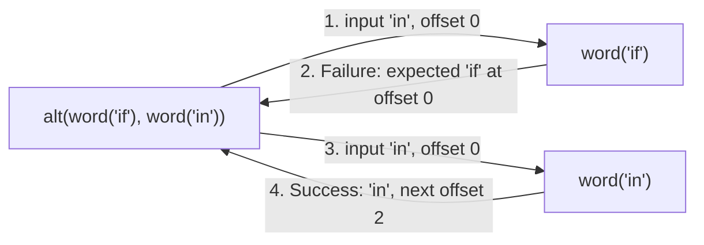

# Reference

> [!WARNING]
> This is the documentation for the `master` branch.
> Things may change or not be complete.
>
> Head over to the [latest stable version](/1.0.0/reference.md) for an up-to-date documentation.

Every function lives in the `jubianchi\PPC` namespace.

## Concepts

### Kinds of functions

PPC has four kinds of functions, each with its own section:

* [**Parsers**](#parsers) read the input.
* [**Combinators**](#combinators) assemble parsers into a new parser, without reading the input themselves.
* [**Modifiers**](#modifiers) run a parser once, at the same offset, and only transform its result: they never read
  more input, and are always applied with the pipe operator.
* [**Runners**](#runners) run a parser on an input and give back its value.

Any combination of parsers, combinators and modifiers is a parser, which can be combined again.

### The parser contract

A parser is a plain closure taking the whole input and the byte offset to start at:

```phps
\Closure(string $input, int $offset, bool $partial = false): Result
```

`Result` is an interface implemented by three final classes:

* On success, it returns a `Success` holding the parsed `value` and the `offset` right after what it consumed.
* On failure, it returns a `Failure` holding the list of what was `expected` and the `offset` where it was expected.
* On a partial input, when [streaming](#stream), it returns an `Incomplete` result when the input ends before it can
  decide. Parsers ignoring the `$partial` argument work too, they just cannot be streamed reliably.

The input is never copied nor sliced: parsers only move an offset forward. Backtracking is free, trying an alternative
only means calling another parser with the same offset.



Since parsers are closures, you can write your own. To be [streamed](#stream), a parser must return an `Incomplete`
result when a partial input ends before it can decide:

```php
<?php

use jubianchi\PPC\Failure;
use jubianchi\PPC\Incomplete;
use jubianchi\PPC\Result;
use jubianchi\PPC\Success;

$digit = static function (string $input, int $offset, bool $partial = false): Result {
    if (!isset($input[$offset])) {
        return $partial ? new Incomplete(1) : new Failure(['digit'], $offset);
    }

    return ctype_digit($input[$offset])
        ? new Success((int) $input[$offset], $offset + 1)
        : new Failure(['digit'], $offset);
};

assert($digit('a1', 1) == new Success(1, 2));
assert($digit('a1', 0) == new Failure(['digit'], 0));
assert($digit('a', 1, partial: true) == new Incomplete(1));
```

Parsers built by PPC declare `Result` as their native return type: a parser returning anything else makes PHP throw a
`TypeError` as soon as it is combined, even without static analysis.

To describe a parser in PHPDoc, use `\Closure(string, int, bool=): (Success<T>|Failure|Incomplete)` rather than
`Result<T>`: PHPStan does not keep `T` when narrowing a `Result<T>` to a `Success`, and combinators expect the union.

### Errors

When every alternative fails, PPC reports the failure that went the furthest in the input, merging what was expected
by failures at the same offset. A `Success` also keeps, as a `hint`, the furthest failure met while succeeding: this is
how `seq(many(char('a')), char('b'))` reports `Expected "a" or "b"` on `aac`.

## Parsers

Parsers are the only functions reading the input.

### char

```phps
function char(string $char): \Closure
```

Matches a single char, which may be multibyte. Its value is the char.

```php
<?php

use function jubianchi\PPC\{char, parse};

assert(parse(char('é'), 'é') === 'é');
```

### word

```phps
function word(string $word): \Closure
```

Matches a non-empty string. Its value is the string.

```php
<?php

use function jubianchi\PPC\{parse, word};

assert(parse(word('true'), 'true') === 'true');
```

### regex

```phps
function regex(string $pattern, int $window = 64): \Closure
```

Matches a PCRE pattern at the offset: the pattern is anchored, it never searches further in the input. Its value is the
whole match. The window only matters when [streaming](#stream).

Matching chunks with a single pattern is much faster than combining parsers matching one char at a time.

```php
<?php

use function jubianchi\PPC\{parse, regex};

assert(parse(regex('/[0-9]+/'), '2026') === '2026');
```

### any

```phps
function any(): \Closure
```

Matches any UTF-8 char, or a single byte when the input is not valid UTF-8. It fails only at the end of the input.

```php
<?php

use function jubianchi\PPC\{any, parse};

assert(parse(any(), '€') === '€');
```

### eos

```phps
function eos(): \Closure
```

Matches the end of the input. Its value is `null`. Use it to make sure a parser consumed the whole input.

```php
<?php

use jubianchi\PPC\SyntaxError;

use function jubianchi\PPC\{char, eos, parse, seq};

try {
    parse(seq(char('a'), eos()), 'ab');
} catch (SyntaxError $error) {
    assert($error->getMessage() === 'Expected end of input, got "b" at line 1, column 2');
}
```

## Combinators

Combinators take parsers and return a parser. They never read the input themselves: they only call their parsers,
possibly several times, at various offsets.

### seq

```phps
function seq(\Closure $first, \Closure ...$parsers): \Closure
```

Matches every parser one after the other. Its value is the list of their values.

```php
<?php

use function jubianchi\PPC\{char, parse, seq};

assert(parse(seq(char('a'), char('b')), 'ab') === ['a', 'b']);
```

### alt

```phps
function alt(\Closure $first, \Closure ...$parsers): \Closure
```

Tries every parser in order, from the same offset, and returns the first success.

```php
<?php

use function jubianchi\PPC\{alt, parse, word};

$boolean = alt(word('true'), word('false'));

assert(parse($boolean, 'false') === 'false');
```

### many / many1

```phps
function many(\Closure $parser): \Closure
function many1(\Closure $parser): \Closure
```

`many` matches the parser zero or more times, `many1` one or more times. Their value is the list of values.

They throw a `LogicException` when the parser succeeds without consuming anything, which would loop forever.

```php
<?php

use function jubianchi\PPC\{char, many, many1, parse, seq};

assert(parse(many(char('a')), '') === []);
assert(parse(many1(char('a')), 'aa') === ['a', 'a']);
```

### repeat

```phps
function repeat(int $times, \Closure $parser): \Closure
```

Matches the parser exactly the given number of times.

```php
<?php

use function jubianchi\PPC\{parse, regex, repeat};

assert(parse(repeat(2, regex('/[0-9]/')), '42') === ['4', '2']);
```

### separated

```phps
function separated(\Closure $separator, \Closure $parser): \Closure
```

Matches the parser zero or more times, separated by the separator. Its value is the list of the parser values, the
separator values are discarded. A trailing separator is not consumed.

```php
<?php

use function jubianchi\PPC\{char, parse, regex, separated};

assert(parse(separated(char(','), regex('/[0-9]/')), '1,2,3') === ['1', '2', '3']);
```

### chainLeft

```phps
function chainLeft(\Closure $operand, \Closure $operator): \Closure
```

Matches the operand one or more times, separated by the operator. The value of the operator is a function combining two
operands: the operands are folded from the left, `a | b | c` being `(a | b) | c`. A trailing operator is not consumed.

It fits any list whose items combine two by two from the left, such as the commands of a shell pipeline, each one
reading the output of everything before it:

```php
<?php

use function jubianchi\PPC\{chainLeft, map, parse, regex};

$command = regex('/[a-z][a-z.\- ]*[a-z]/') |> map(static fn (string $line): array => ['run', $line]);
$pipe = regex('/ \| /') |> map(static fn (): \Closure => static fn (array $from, array $to): array => ['pipe', $from, $to]);

assert(parse(chainLeft($command, $pipe), 'cat access.log | grep error | wc -l') === [
    'pipe',
    ['pipe', ['run', 'cat access.log'], ['run', 'grep error']],
    ['run', 'wc -l'],
]);
```

Chaining chains gives operators their precedence: below, the operands of a sum are products.

```php
<?php

use function jubianchi\PPC\{alt, chainLeft, char, map, parse, regex};

$number = regex('/[0-9]+/') |> map(intval(...));
$operator = static fn (string $symbol, \Closure $apply): \Closure => char($symbol) |> map(static fn (): \Closure => $apply);

$product = chainLeft($number, alt(
    $operator('*', static fn (int $a, int $b): int => $a * $b),
    $operator('/', static fn (int $a, int $b): int => intdiv($a, $b)),
));
$sum = chainLeft($product, alt(
    $operator('+', static fn (int $a, int $b): int => $a + $b),
    $operator('-', static fn (int $a, int $b): int => $a - $b),
));

assert(parse($sum, '10-2-3') === 5);
assert(parse($sum, '1+2*3') === 7);
```

### chainRight

```phps
function chainRight(\Closure $operand, \Closure $operator): \Closure
```

Like [`chainLeft`](#chainleft), but the operands are folded from the right, `a -> b -> c` being `a -> (b -> c)`: for
right-associative operators.

Function types are an example: `int -> string -> bool` is a function taking an `int` and returning a function from
`string` to `bool`.

```php
<?php

use function jubianchi\PPC\{chainRight, map, parse, regex, word};

$type = regex('/[a-z]+/');
$arrow = word(' -> ') |> map(static fn (): \Closure => static fn (array|string $from, array|string $to): array => ['fn', $from, $to]);

assert(parse(chainRight($type, $arrow), 'int -> string -> bool') === ['fn', 'int', ['fn', 'string', 'bool']]);
```

So is the power operator:

```php
<?php

use function jubianchi\PPC\{chainRight, char, map, parse, regex};

$number = regex('/[0-9]+/') |> map(intval(...));
$power = chainRight($number, char('^') |> map(static fn (): \Closure => static fn (int $a, int $b): int => $a ** $b));

assert(parse($power, '2^3^2') === 512);
```

### enclosed

```phps
function enclosed(\Closure $before, \Closure $parser, ?\Closure $after = null): \Closure
```

Matches the parser between two others, which default to the same one. Its value is the value of the enclosed parser.

```php
<?php

use function jubianchi\PPC\{char, enclosed, parse, regex};

assert(parse(enclosed(char('"'), regex('/[a-z]*/')), '"ppc"') === 'ppc');
assert(parse(enclosed(char('('), regex('/[a-z]*/'), char(')')), '(ppc)') === 'ppc');
```

### preceded

```phps
function preceded(\Closure $before, \Closure $parser): \Closure
```

Matches the parser after another one. Its value is the value of the parser, the value of the prefix being dropped.

```php
<?php

use function jubianchi\PPC\{char, map, parse, preceded, regex};

$number = regex('/[0-9]+/') |> map(intval(...));
$negative = preceded(char('-'), $number) |> map(static fn (int $number): int => -$number);

assert(parse($negative, '-42') === -42);
```

### terminated

```phps
function terminated(\Closure $parser, \Closure $after): \Closure
```

Matches the parser before another one. Its value is the value of the parser, the value of the suffix being dropped.

```php
<?php

use function jubianchi\PPC\{char, parse, regex, seq, terminated};

$pair = seq(terminated(regex('/[a-z]+/'), char('=')), regex('/[a-z]+/'));

assert(parse($pair, 'key=value') === ['key', 'value']);
```

### bind

```phps
function bind(\Closure $parser, \Closure $next): \Closure
```

Builds the next parser from the value of the parser, and runs it where the parser stopped. Its value is the value of the
next parser. It makes the grammar depend on what was read before: a closing tag matching the opening one, a
length-prefixed field…

```php
<?php

use jubianchi\PPC\SyntaxError;

use function jubianchi\PPC\{alt, any, bind, capture, char, enclosed, map, parse, regex, repeat, terminated, word};

$element = bind(
    enclosed(char('<'), regex('/\w+/'), char('>')),
    static fn (string $tag): \Closure => terminated(regex('/[^<]*/'), word("</{$tag}>")),
);

assert(parse($element, '<b>bold</b>') === 'bold');
assert(parse(alt($element, regex('/.*/')), '<b>bold</i>') === '<b>bold</i>');

try {
    parse($element, '<b>bold</i>');
} catch (SyntaxError $error) {
    assert($error->getMessage() === 'Expected "</b>", got "<" at line 1, column 8');
}

$netstring = bind(
    regex('/[0-9]+/') |> map(intval(...)),
    static fn (int $length): \Closure => enclosed(char(':'), repeat($length, any()) |> capture(), char(',')),
);

assert(parse($netstring, '5:hello,') === 'hello');
```

A check made in a `map()` instead could only throw an exception: unlike a failure, it has no position and `alt()` cannot
try the next alternative.

### anyBut

```phps
function anyBut(\Closure $parser): \Closure
```

Matches any char, unless the parser matches at the offset. To check what comes next without consuming it, use
[`negate`](#negate).

```php
<?php

use function jubianchi\PPC\{anyBut, capture, char, many, parse};

assert(parse(many(anyBut(char(';'))) |> capture(), 'abc') === 'abc');
```

### recursive

```phps
function recursive(\Closure $definition): \Closure
```

Defines a parser referring to itself: the definition receives the parser being defined and returns it.

```php
<?php

use function jubianchi\PPC\{alt, char, enclosed, parse, recursive};

$nested = recursive(static fn (\Closure $nested): \Closure => alt(
    char('x'),
    enclosed(char('('), $nested, char(')')),
));

assert(parse($nested, '((x))') === 'x');
```

A left-recursive definition, calling itself before consuming any input, would never end: the parser throws a
`LogicException` instead. Such a grammar has to be rewritten so that the recursion comes after some input, e.g. with
[`chainLeft`](#chainleft) for left-associative operators.

```php
<?php

use function jubianchi\PPC\{alt, char, parse, recursive, seq};

$sum = recursive(static fn (\Closure $sum): \Closure => alt(
    seq($sum, char('+'), char('1')),
    char('1'),
));

try {
    parse($sum, '1+1');
} catch (\LogicException $exception) {
    $message = $exception->getMessage();
}

assert($message === 'Left recursion detected at offset 0: the recursive parser calls itself without consuming input, use chainLeft() for left-associative operators');
```

## Modifiers

Modifiers return a function wrapping a parser, applied with the pipe operator: `$parser |> map(...)`. They run the
parser once, at the same offset, and only transform its result: they never read more input.

### map

```phps
function map(\Closure $mapper): \Closure
```

Transforms the value of a successful parser.

```php
<?php

use function jubianchi\PPC\{map, parse, regex};

$number = regex('/[0-9]+/') |> map(intval(...));

assert(parse($number, '42') === 42);
```

### label

```phps
function label(string $label): \Closure
```

Replaces what the parser expects in error messages, when it fails without consuming anything.

```php
<?php

use jubianchi\PPC\SyntaxError;

use function jubianchi\PPC\{label, parse, regex};

try {
    parse(regex('/[0-9]+/') |> label('number'), 'x');
} catch (SyntaxError $error) {
    assert($error->getMessage() === 'Expected number, got "x" at line 1, column 1');
}
```

### optional

```phps
function optional(mixed $default = null): \Closure
```

Matches the parser or nothing. When the parser fails, its value is the default, and no input is consumed.

```php
<?php

use function jubianchi\PPC\{char, optional, parse, seq};

$signed = seq(char('-') |> optional('+'), char('1'));

assert(parse($signed, '1') === ['+', '1']);
assert(parse($signed, '-1') === ['-', '1']);
```

### capture

```phps
function capture(): \Closure
```

Replaces the value of the parser with the text it consumed.

```php
<?php

use function jubianchi\PPC\{capture, char, optional, parse, regex, seq};

$decimal = seq(regex('/[0-9]+/'), seq(char('.'), regex('/[0-9]+/')) |> optional()) |> capture();

assert(parse($decimal, '3.14') === '3.14');
```

### peek

```phps
function peek(): \Closure
```

Looks ahead: succeeds with the value of the parser, without consuming input.

```php
<?php

use function jubianchi\PPC\{parse, peek, regex, seq};

$signed = seq(regex('/[+-]/') |> peek(), regex('/[+-][0-9]+/'));

assert(parse($signed, '-1') === ['-', '-1']);
```

### negate

```phps
function negate(): \Closure
```

Negative lookahead: succeeds with `null` when the parser fails, and fails when it succeeds, never consuming input. Unlike
[`anyBut`](#anybut), which consumes a char, it only checks what comes next, e.g. to keep a keyword from matching the
start of a longer word.

```php
<?php

use jubianchi\PPC\SyntaxError;

use function jubianchi\PPC\{char, negate, parse, regex, seq, terminated, word};

$if = terminated(word('if'), regex('/\w/') |> negate());

assert(parse(seq($if, char(' '), char('x')), 'if x') === ['if', ' ', 'x']);

try {
    parse(seq($if, char(' '), char('x')), 'iffy x');
} catch (SyntaxError $error) {
    assert($error->getMessage() === 'Expected anything but "f", got "f" at line 1, column 3');
}
```

### debug

```phps
function debug(string $name, \Closure $write): \Closure
```

Traces where the parser starts and what it matched, why it failed or how many bytes it was missing on a partial input.
Each line is passed to the `$write` function, for example `error_log(...)`.

```php
<?php

use function jubianchi\PPC\{char, debug, many, parse, word};

$lines = [];
$write = static function (string $line) use (&$lines): void {
    $lines[] = $line;
};

parse(many(char('a')) |> debug('as', $write), 'aa');
(word('true') |> debug('true', $write))('tr', 0, partial: true);

assert($lines === [
    'as: start at line 1, column 1',
    'as: matched "aa" up to line 1, column 3',
    'true: start at line 1, column 1',
    'true: incomplete input, 2 more bytes needed',
]);
```

## Runners

Runners run a parser on an input and give back its value. Each comes in two variants: `parse()` and `stream()` throw
syntax errors, `tryParse()` and `tryStream()` return them. Other errors, like a parser returning `Incomplete` on a
complete input, are programming errors thrown by both.

A `SyntaxError` tells what was expected, what was found and where in its message. It also holds the `Failure` in its
`failure` property, and the line and column of the error, in chars, in its `position` property.

### parse

```phps
function parse(\Closure $parser, string $input): mixed
```

Runs the parser from the start of the input and returns its value. On failure, it throws a `SyntaxError`.

```php
<?php

use jubianchi\PPC\SyntaxError;

use function jubianchi\PPC\{many, char, parse, seq};

$parser = seq(many(char('a')), char('b'));

assert(parse($parser, 'aab') === [['a', 'a'], 'b']);

try {
    parse($parser, "aa\nc");
} catch (SyntaxError $error) {
    assert($error->getMessage() === 'Expected "a" or "b", got "\n" at line 1, column 3');
    assert($error->failure->offset === 2);
    assert($error->position->line === 1 && $error->position->column === 3);
}
```

### tryParse

```phps
function tryParse(\Closure $parser, string $input): mixed
```

Like [`parse`](#parse), but returns the `SyntaxError` instead of throwing it.

```php
<?php

use jubianchi\PPC\SyntaxError;

use function jubianchi\PPC\{many, char, seq, tryParse};

$parser = seq(many(char('a')), char('b'));

assert(tryParse($parser, 'aab') === [['a', 'a'], 'b']);

$error = tryParse($parser, "aa\nc");

assert($error instanceof SyntaxError);
assert($error->getMessage() === 'Expected "a" or "b", got "\n" at line 1, column 3');
```

### stream

```phps
function stream(\Closure $item, resource $source, int $chunk = 8192): \Generator
```

Parses the items of a source, a file or a socket for example, one after the other while reading it by chunks: only the
items being parsed are kept in memory, never the whole source. Each item value is yielded as soon as it is parsed, and
syntax errors are thrown as `SyntaxError` with their absolute position in the source.

Until the end of the source, parsers are given a third argument telling the input is partial. When the input ends
before they can decide, they return an `Incomplete` result instead of failing, like nom does: `stream` then reads more
bytes and parses the item again from its start.

PHP does not expose partial matching for regular expressions: on a partial input, a `regex` result is only trusted
when the input extends at least `$window` bytes past where it stopped. Give a larger window to patterns needing more
bytes to decide, or a smaller one to patterns which only look at the next byte, to read less.

```php
<?php

use function jubianchi\PPC\{char, map, regex, seq, stream};

$source = fopen('php://memory', 'w+');
fwrite($source, "1,ppc\n2,parser\n3,combinator\n");
rewind($source);

$record = seq(regex('/[0-9]+/', 1), char(','), regex('/[a-z]+/', 1), char("\n"))
    |> map(static fn (array $values): array => [(int) $values[0] => $values[2]]);

$records = [];

foreach (stream($record, $source, chunk: 4) as $value) {
    $records += $value;
}

assert($records === [1 => 'ppc', 2 => 'parser', 3 => 'combinator']);
```

### tryStream

```phps
function tryStream(\Closure $item, resource $source, int $chunk = 8192): \Generator
```

Like [`stream`](#stream), but yields the `SyntaxError` instead of throwing it. Parsing cannot resume after an error: the
`SyntaxError` is the last value, after all the valid items before it.

```php
<?php

use jubianchi\PPC\SyntaxError;

use function jubianchi\PPC\{char, map, regex, seq, tryStream};

$source = fopen('php://memory', 'w+');
fwrite($source, "1,ppc\n2,parser\nthree,combinator\n");
rewind($source);

$record = seq(regex('/[0-9]+/', 1), char(','), regex('/[a-z]+/', 1), char("\n"))
    |> map(static fn (array $values): string => $values[2]);

$values = iterator_to_array(tryStream($record, $source, chunk: 4), false);

assert(array_slice($values, 0, 2) === ['ppc', 'parser']);
assert($values[2] instanceof SyntaxError);
assert($values[2]->position->line === 3 && $values[2]->position->column === 1);
```
